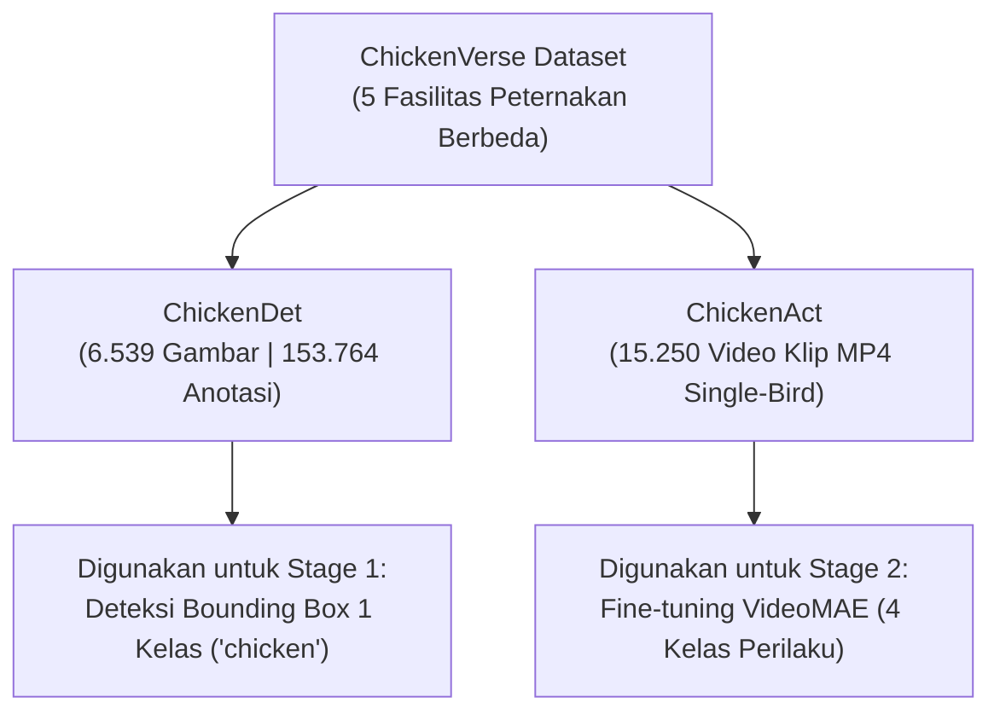
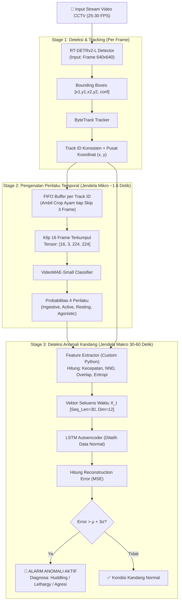
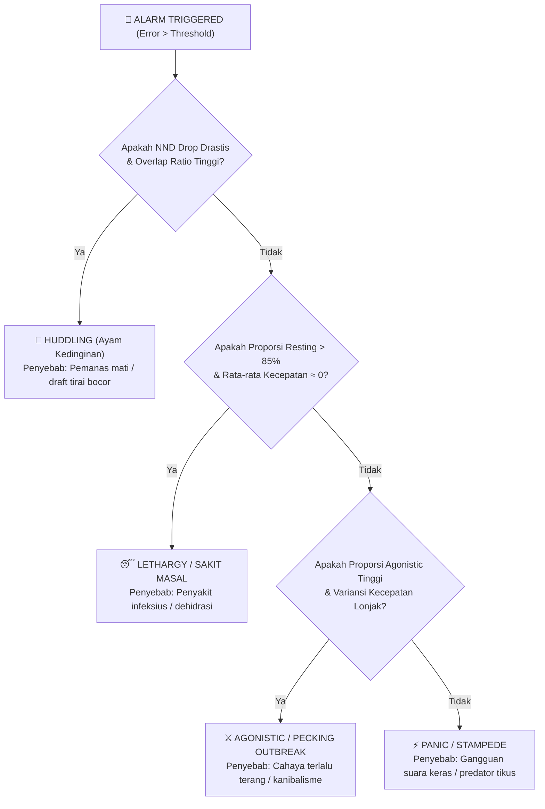

# 📘 Whitepaper & Spesifikasi Lengkap Sistem Deteksi Anomali Kandang Ayam Broiler
### Berbasis Computer Vision & Deep Learning Menggunakan ChickenVerse Dataset

---

## 📑 Daftar Isi
1. [Latar Belakang & Pernyataan Masalah](#1-latar-belakang--pernyataan-masalah)
2. [Dataset: ChickenVerse & Pemanfaatannya](#2-dataset-chickenverse--pemanfaatannya)
3. [Arsitektur Pipeline 3-Stage End-to-End](#3-arsitektur-pipeline-3-stage-end-to-end)
4. [Justifikasi & Alasan Pemilihan Setiap Komponen](#4-justifikasi--alasan-pemilihan-setiap-komponen)
   - [4.1 Stage 1: Mengapa RT-DETRv2-L + ByteTrack?](#41-stage-1-mengapa-rt-detrv2-l--bytetrack)
   - [4.2 Stage 2: Mengapa VideoMAE-Small?](#42-stage-2-mengapa-videomae-small)
   - [4.3 Pemetaan Label: Mengapa 15 Kelas Disederhanakan Menjadi 4 Kelas?](#43-pemetaan-label-mengapa-15-kelas-disederhanakan-menjadi-4-kelas)
   - [4.4 Skala Waktu: Mengapa 16 Frame (~1,6 Detik) vs 1 Menit?](#44-skala-waktu-mengapa-16-frame-16-detik-vs-1-menit)
   - [4.5 Stage 3: Mengapa Unsupervised LSTM Autoencoder?](#45-stage-3-mengapa-unsupervised-lstm-autoencoder)
5. [Bedah Formula Matematika & Kamus Variabel Lengkap](#5-bedah-formula-matematika--kamus-variabel-lengkap)
   - [5.1 Formula Feature Extractor (Spasial & Kinematik)](#51-formula-feature-extractor-spasial--kinematik)
   - [5.2 Formula LSTM Autoencoder (Gerbang & Memori)](#52-formula-lstm-autoencoder-gerbang--memori)
   - [5.3 Formula Skor Rekonstruksi & Ambang Batas 3-Sigma](#53-formula-skor-rekonstruksi--ambang-batas-3-sigma)
6. [Taksonomi Deteksi Anomali di Kandang](#6-taksonomi-deteksi-anomali-di-kandang)
7. [Estimasi Kebutuhan Komputasi & Rekomendasi Deployment](#7-estimasi-kebutuhan-komputasi--rekomendasi-deployment)

---

## 1. Latar Belakang & Pernyataan Masalah

Pemeliharaan ayam broiler modern dilakukan dalam kepadatan tinggi (stocking density hingga puluhan ribu ekor per kandang closed-house). Pengawasan manual memiliki kelemahan kritis:
1. **Pemeriksaan Berkala Terbatas**: Peternak hanya masuk 2–3 kali sehari, sehingga anomali seperti pendinginan mendadak (*chilling*) atau kerusakan jalur air sering terlambat disadari.
2. **Stres Hewan**: Kehadiran manusia di dalam kandang memicu kepanikan dan mengacaukan pola alami ayam.
3. **Ketidakmampuan Mengamati Dinamika Temporal**: Foto statis tidak dapat membedakan ayam yang tidur sehat vs ayam lemas sakit (*lethargic*), karena keduanya sama-sama terdiam. Kuncinya ada pada **analisis deret waktu (temporal)**.

Solusi yang dibangun adalah sistem pemantauan non-invasif berbasis kamera atas yang bekerja dalam 3 tahap berjenjang:
$$\text{Deteksi Ayam} \longrightarrow \text{Klasifikasi Perilaku Dinamis} \longrightarrow \text{Deteksi Anomali Temporal}$$

---

## 2. Dataset: ChickenVerse & Pemanfaatannya

Proyek ini memanfaatkan dataset benchmark terbuka **ChickenVerse** ([GitHub: amirivojdan/ChickenVerse](https://github.com/amirivojdan/ChickenVerse)) yang memiliki dua sub-koleksi:



* **Keunggulan Dataset**: Data diambil dari berbagai sudut kamera (overhead dan oblique) serta kondisi pencahayaan komersial dan eksperimental, menjamin model tidak *overfitting* pada satu kandang saja.

---

## 3. Arsitektur Pipeline 3-Stage End-to-End



---

## 4. Justifikasi & Alasan Pemilihan Setiap Komponen

### 4.1 Stage 1: Mengapa RT-DETRv2-L + ByteTrack?

#### Mengapa RT-DETRv2-L (Real-Time Detection Transformer)?
1. **Bebas Non-Maximum Suppression (NMS-free)**: Arsitektur berbasis Transformer (Hungarian matching) tidak memerlukan tahap NMS pasca-proses. Pada kandang ayam yang sangat padat di mana ayam saling bersinggungan erat, NMS tradisional (seperti pada YOLOv5/v7) sering salah menghapus bounding box ayam asli karena dianggap duplikat.
2. **Kinerja Baseline ChickenVerse**: Model RT-DETR merupakan baseline resmi yang diuji oleh pembuat dataset ChickenVerse dengan akurasi mAP tertinggi pada skenario *cross-facility*.
3. **Kecepatan Real-time**: Meskipun berbasis Transformer, varian v2 dioptimalkan untuk latensi rendah sehingga sanggup berjalan di GPU laptop/PC (>35 FPS).

#### Mengapa ByteTrack?
1. **Asosiasi Deteksi Probabilitas Rendah (*Low-Score Association*)**: ByteTrack tidak membuang deteksi yang memiliki skor confidence rendah (misal saat ayam tertutup sebagian oleh tempat makan/minum). Algoritmanya mengasosiasikan deteksi confidence tinggi lebih dulu, lalu mencocokkan deteksi rendah dengan sisa tracklets. Ini mencegah putusnya `track_id` saat ayam berdesakan.
2. **Tanpa Komputasi Ekstra Re-ID**: Tidak membutuhkan model ekstraksi fitur penampilan terpisah (seperti DeepSORT), menjadikannya sangat cepat.

---

### 4.2 Stage 2: Mengapa VideoMAE-Small?

#### Perbandingan dengan Arsitektur Video Lain:

| Model | Keunggulan | Kelemahan | Kesimpulan untuk Proyek Ini |
| :--- | :--- | :--- | :--- |
| **2D CNN + LSTM** | Sangat ringan | Memproses frame secara terpisah; gagal menangkap interaksi temporal spasial lokal halus. | ❌ Kurang akurat untuk gerakan mikro ayam. |
| **3D CNN (X3D / I3D)** | Baik untuk video aksi umum | Komputasi kernel 3D berat; sulit menangani sequence masking. | ⚠️ Terlalu berat jika batch size per-ayam banyak. |
| **TimeSformer** | Attention penuh di ruang & waktu | Butuh data latih raksasa; sering overfit jika fine-tune pada dataset terbatas. | ⚠️ Kurang efisien dibanding VideoMAE. |
| **VideoMAE-Small** *(Pilihan)* | **Masking rasio 90%** memaksa model belajar representasi gerak (*motion continuity*); bobot ringan (~22M parameter); transfer learning sangat tajam. | Butuh sequence frame teratur. | ✅ **Paling ideal untuk gerakan mikro ayam & ramah laptop/PC.** |

> [!NOTE]
> **Mengapa Masking 90% Penting untuk Ayam?**  
> Sekam kandang dan bulu ayam broiler sama-sama berwarna krem/putih. Jika model dilatih tanpa masking agresif, model hanya mengenali tekstur sekam atau bentuk statis tubuh ayam. Masking 90% memaksa VideoMAE menghubungkan lintasan piksel antar-frame, sehingga fokus utama model murni pada **gerakan fisik ayam**.

---

### 4.3 Pemetaan Label: Mengapa 15 Kelas Disederhanakan Menjadi 4 Kelas?

Dataset ChickenAct memiliki 15 perilaku mikro (misal: *dust bathing*, *preening*, *wing flapping*, *pecking ground*, dll). Dalam operasional kandang komersial, 15 kelas ini memiliki tumpang tindih semantik tinggi yang membingungkan classifier jika resolusi CCTV terbatas. 

Oleh karena itu, dilakukan pemetaan fungsional ke **4 Kategori Relevansi Kesejahteraan**:

```
[15 KELAS CHICKENACT]                         [4 KELAS SISTEM KITA]
┌──────────────────────────────────────┐     ┌───────────────────────────────────┐
│ • eating                             │ ──► │ 1. INGESTIVE                      │
│ • drinking                           │     │    Perilaku konsumsi pakan/air.   │
│ • pecking_ground                     │     │    Indikator metabolisme primer.  │
├──────────────────────────────────────┤     ├───────────────────────────────────┤
│ • walking                            │ ──► │ 2. ACTIVE                         │
│ • running                            │     │    Mobilitas & lokomosi.          │
│ • wing_flapping                      │     │    Indikator kesehatan kaki.      │
├──────────────────────────────────────┤     ├───────────────────────────────────┤
│ • resting                            │ ──► │ 3. RESTING                        │
│ • sitting                            │     │    Perilaku istirahat normal &    │
│ • standing                           │     │    perawatan tubuh wajar.         │
│ • preening / dust_bathing            │     │                                   │
├──────────────────────────────────────┤     ├───────────────────────────────────┤
│ • pecking_other                      │ ──► │ 4. AGONISTIC / ABNORMAL           │
│ • fighting / head_shaking            │     │    Perilaku stres, kanibalisme,   │
│ • erratic movement / distress        │     │    atau kepanikan sosial.         │
└──────────────────────────────────────┘     └───────────────────────────────────┘
```

**Alasan Teknis & Bisnis:**
1. **Reduksi Imbalance Data**: Pada ChickenAct, aksi *dust bathing* sangat langka dibanding *sitting*. Menggabungkannya menyeimbangkan distribusi data latih.
2. **Korelasi Langsung dengan Alarm**: Peternak tidak butuh tahu apakah ayam merapikan bulu sayap kiri atau kanan; peternak hanya butuh tahu: *Apakah ayam makan cukup? Apakah ayam diam lemas? Apakah terjadi saling patuk?*

---

### 4.4 Skala Waktu: Mengapa 16 Frame (~1,6 Detik) vs 1 Menit?

Terdapat pemisahan tegas antara **Deteksi Tindakan (Action)** dan **Deteksi Tren (Anomaly)**:

```
                  WAKTU NYATA (TIMELINE)
─────────────────────────────────────────────────────────────►
[0.0s] ─────── [1.6s] ─────── [3.2s] ───────────── [60.0s]
  └─ 16 Frame ─┘
   (VideoMAE)
   "Sedang apa ayam ini detik ini?"
   -> Output: RESTING

  └─────────────── Jendela Akumulasi 1 Menit ───────────────┘
                               (LSTM-AE)
                  "Apakah wajar jika ayam ini diam 100%
                   selama 1 menit saat lampu makan menyala?"
                   -> Output: ANOMALI (Lethargy)
```

* **16 Frame dengan Stride 3 ($\approx 1{,}6$ detik)**:
  Kamera merekam pada 30 FPS. Jika mengambil 16 frame berturut-turut tanpa jeda, rentangnya hanya 0,5 detik (terlalu singkat untuk melihat satu langkah kaki utuh). Dengan mengambil 1 frame tiap 3 frame ($16 \times 3 = 48 \text{ frame}$ asli), durasi menjadi 1,6 detik—rentang ideal untuk menyelesaikan 1 siklus gerakan (misal: paruh mematuk lalu kembali tegak).
* **1 Menit pada Stage 3**:
  Ayam yang diam selama 2 detik adalah kondisi sangat normal. Namun ayam yang terdiam selama 1 menit penuh saat ayam lain aktif berebut pakan adalah indikasi kuat penyakit. Oleh karena itu, agregasi tren dilakukan di jendela makro (30–60 detik).

---

### 4.5 Stage 3: Mengapa Unsupervised LSTM Autoencoder?

#### Mengapa Pendekatan Unsupervised?
1. **Kelangkaan Data Anomali**: Di dunia nyata, 98% waktu kandang berada dalam kondisi normal. Sangat sulit mengumpulkan rekaman video kecelakaan kandang (seperti blower mati atau wabah flu burung) dalam jumlah ribuan untuk melatih classifier *supervised* secara seimbang.
2. **Kemampuan Mendeteksi Anomali Tak Terduga (*Zero-Shot Anomalies*)**: Pendekatan supervised hanya mengenali anomali yang pernah diajarkan. Autoencoder mempelajari batas kebiasaan normal; apapun bentuk keanehan yang melenceng dari normal akan otomatis memicu error rekonstruksi tinggi.

#### Mengapa LSTM Autoencoder?
Kondisi kandang memiliki ketergantungan urutan (*temporal dependency*). Misalnya: ayam diam setelah berlarian adalah wajar (istirahat), tetapi ayam diam yang didahului penurunan bertahap frekuensi makan selama 30 menit menandakan timbulnya gejala sakit. LSTM memiliki gerbang memori yang mampu menangkap dinamika urutan waktu tersebut.

---

## 5. Bedah Formula Matematika & Kamus Variabel Lengkap

---

### 5.1 Formula Feature Extractor (Spasial & Kinematik)

Fitur dihitung setiap jendela waktu $T$ oleh modul custom Python.

#### 1. Kecepatan Translasi Individu ($v_i$) & Rata-rata Populasi ($\bar{v}$)
Mengukur seberapa lincah ayam berpindah posisi di lantai kandang.

$$v_i(t) = \frac{\sqrt{(x_{i, t} - x_{i, t-\Delta t})^2 + (y_{i, t} - y_{i, t-\Delta t})^2}}{\Delta t}$$

$$\bar{v}(t) = \frac{1}{N} \sum_{i=1}^{N} v_i(t)$$

| Variabel | Tipe Data | Definisi & Makna Nyata |
| :--- | :---: | :--- |
| $x_{i,t}, y_{i,t}$ | Float | Titik tengah (*centroid*) bounding box ayam ke-$i$ pada frame waktu $t$. |
| $\Delta t$ | Float | Selang waktu antar-pembacaan (dalam detik). |
| $v_i(t)$ | Float | Kecepatan gerak linear ayam ke-$i$ (satuan: piksel/detik). |
| $N$ | Integer | Jumlah total ayam terdeteksi pada frame tersebut. |
| $\bar{v}(t)$ | Float | Kecepatan rata-rata seluruh kawanan ayam di kandang. |

---

#### 2. Jarak Tetangga Terdekat / *Nearest Neighbor Distance* (NND)
Mengukur tingkat kepadatan lokal antar-individu untuk mendeteksi penumpukan dingin (*huddling*).

$$d_{i, \text{nearest}} = \min_{j \in \{1 \dots N\}, j \neq i} \sqrt{(x_i - x_j)^2 + (y_i - y_j)^2}$$

$$\text{NND}_{\text{avg}} = \frac{1}{N} \sum_{i=1}^{N} d_{i, \text{nearest}}$$

| Variabel | Tipe Data | Definisi & Makna Nyata |
| :--- | :---: | :--- |
| $d_{i, \text{nearest}}$ | Float | Jarak piksel dari ayam $i$ ke ayam lain terdekat yang ada di sekitarnya. |
| $\min_{j \neq i}$ | Operator | Mencari jarak minimum ke ayam lain selain dirinya sendiri. |
| $\text{NND}_{\text{avg}}$ | Float | Rata-rata jarak terdekat populasi. Jika nilai ini anjlok drastis $\to$ ayam berkerumun rapat menempel. |

---

#### 3. Rasio Tumpukan Bounding Box (*Spatial Overlap Ratio*)
Mengukur fenomena ayam yang saling memanjat/menumpuk dari sudut pandang atas (*overhead*).

$$\text{IoU}(B_i, B_j) = \frac{\text{Luas}(B_i \cap B_j)}{\text{Luas}(B_i \cup B_j)}$$

$$\text{Overlap Ratio} = \frac{\sum_{i=1}^{N-1} \sum_{j=i+1}^{N} \mathbb{I}\Big(\text{IoU}(B_i, B_j) > 0{,}20\Big)}{\frac{N(N-1)}{2}}$$

| Variabel | Tipe Data | Definisi & Makna Nyata |
| :--- | :---: | :--- |
| $B_i, B_j$ | Koordinat Box | Bounding box koordinat ayam $i$ dan $j$ $[x_1, y_1, x_2, y_2]$. |
| $\text{IoU}$ | Float $[0, 1]$ | *Intersection over Union*, rasio area irisan terhadap area gabungan box. |
| $\mathbb{I}(\dots)$ | Fungsi Indikator | Bernilai **1** jika IoU $> 0{,}20$ (terjadi tumpukan signifikan), dan bernilai **0** jika tidak. |
| $\frac{N(N-1)}{2}$ | Integer | Rumus kombinasi total pasangan ayam unik yang mungkin terbentuk. |
| $\text{Overlap Ratio}$ | Float $[0, 1]$ | Persentase pasangan ayam di kandang yang saling menindih. |

---

#### 4. Entropi Keragaman Perilaku (*Shannon Behavioral Entropy*)
Mengukur variasi alami aktivitas kawanan ayam.

$$H(t) = - \sum_{k=1}^{4} p_k(t) \cdot \log_2\big(p_k(t) + \epsilon\big)$$

| Variabel | Tipe Data | Definisi & Makna Nyata |
| :--- | :---: | :--- |
| $p_k(t)$ | Float $[0, 1]$ | Proporsi ayam di kandang yang melakukan perilaku ke-$k$ (Ingestive, Active, Resting, Agonistic). |
| $\epsilon$ | Float ($10^{-7}$) | Konstanta sangat kecil untuk mencegah kesalahan komputasi $\log_2(0)$. |
| $H(t)$ | Float $[0, 2]$ | Nilai keragaman. Kondisi normal $\approx 1{,}3 - 1{,}8$. Jika nilai mendekati $0 \to$ seluruh kandang seragam diam atau seragam panik. |

---

### 5.2 Formula LSTM Autoencoder (Gerbang & Memori)

Untuk setiap langkah waktu $t$ dalam sekuens input berdimensi $D$:
Input vektor: $x_t \in \mathbb{R}^D$  
Hidden state sebelumnya: $h_{t-1} \in \mathbb{R}^H$  
Cell state sebelumnya: $C_{t-1} \in \mathbb{R}^H$

```
                   ┌──────────────────────────────────────────────┐
                   │               Sel LSTM Internal              │
                   │                                              │
    C_{t-1} ───────┼───────────[ * ]──────────────────(+)─────────┼──────► C_t
                   │            ▲                      ▲          │
                   │            │ (f_t)                │          │
                   │            │           (i_t) [*]  │          │
                   │            │                  ▲   │          │
                   │            │          ┌───────┴───┴──────┐   │
                   │            │          │  C_tilde = tanh  │   │
                   │            │          │    i_t = sigma   │   │
                   │            │          │    f_t = sigma   │   │
                   │            │          │    o_t = sigma   │   │
                   │            │          └───────┬──────────┘   │
                   │            │                  │              │
                   │            │                  ▼ (o_t)        │
    h_{t-1} ───────┼────────────┴───────────────►[*]──────────────┼──────► h_t
    x_t     ───────┼──────────────────────────────┘ (tanh(C_t))   │
                   └──────────────────────────────────────────────┘
```

#### Persamaan Matematis:
1. **Forget Gate**: $f_t = \sigma(W_f \cdot [h_{t-1}, x_t] + b_f)$
2. **Input Gate**: $i_t = \sigma(W_i \cdot [h_{t-1}, x_t] + b_i)$
3. **Candidate State**: $\tilde{C}_t = \tanh(W_c \cdot [h_{t-1}, x_t] + b_c)$
4. **New Cell State**: $C_t = f_t \odot C_{t-1} + i_t \odot \tilde{C}_t$
5. **Output Gate**: $o_t = \sigma(W_o \cdot [h_{t-1}, x_t] + b_o)$
6. **New Hidden State**: $h_t = o_t \odot \tanh(C_t)$

| Variabel | Dimensi | Definisi Matematis & Konteks Nyata |
| :--- | :---: | :--- |
| $x_t$ | $[D]$ | Vektor gabungan fitur kandang saat detik ke-$t$ ($D=12$ fitur). |
| $h_{t-1}, h_t$ | $[H]$ | Vektor representasi temporal jangka pendek ($H=64$ hidden units). |
| $C_{t-1}, C_t$ | $[H]$ | *Cell State*: Jalur transmisi memori jangka panjang tanpa perubahan non-linear drastis. |
| $f_t$ | $[H]$ | Saklar lupa: Elemen bernilai mendekati $0$ melupakan tren lama, mendekati $1$ mengingatnya. |
| $i_t$ | $[H]$ | Saklar masuk: Menentukan seberapa besar fitur detik ini diizinkan mengubah memori. |
| $\tilde{C}_t$ | $[H]$ | Informasi kandidat baru hasil ekstraksi non-linear fungsi $\tanh$. |
| $o_t$ | $[H]$ | Saklar output: Memfilter bagian $C_t$ mana yang layak dijadikan output kesimpulan saat ini. |
| $W_f, W_i, W_c, W_o$ | $[H \times (H+D)]$ | Matriks bobot terpelajar yang mengalikan gabungan vektor $[h_{t-1}, x_t]$. |
| $b_f, b_i, b_c, b_o$ | $[H]$ | Vektor bias yang digeser selama optimasi gradient descent. |
| $\sigma(z) = \frac{1}{1 + e^{-z}}$ | Fungsi | Sigmoid: Memetakan nilai ke skala probabilitas $[0, 1]$. |
| $\tanh(z) = \frac{e^z - e^{-z}}{e^z + e^{-z}}$ | Fungsi | Tangen Hiperbolik: Memetakan nilai ke rentang dinamis $[-1, 1]$. |
| $\odot$ | Operator | Perkalian titik elemen-demi-elemen (*Hadamard product*). |

---

### 5.3 Formula Skor Rekonstruksi & Ambang Batas 3-Sigma

Decoder menghasilkan sekuens tebakan $\hat{X}$. Error rekonstruksi dihitung menggunakan **Mean Squared Error (MSE)**:

$$\mathcal{L}_{\text{MSE}}(t) = \frac{1}{S \cdot D} \sum_{s=1}^{S} \sum_{d=1}^{D} \Big(X_{s, d} - \hat{X}_{s, d}\Big)^2$$

| Variabel | Definisi |
| :--- | :--- |
| $S$ | Panjang langkah sekuens waktu dalam satu jendela evaluasi (misal $S = 30$ time-steps). |
| $D$ | Banyaknya fitur yang diamati ($D = 12$). |
| $X_{s,d}$ | Nilai riil fitur ke-$d$ pada langkah waktu ke-$s$. |
| $\hat{X}_{s,d}$ | Nilai fitur yang berhasil ditebak/direkonstruksi oleh Decoder Autoencoder. |
| $\mathcal{L}_{\text{MSE}}(t)$ | Nilai skor anomali saat ini. |

#### Ambang Batas Statistik (Dynamic Threshold $\tau$):
Selama fase validasi pada kumpulan data rekaman kondisi normal, dicatat seluruh nilai error $\mathcal{L}$. Dihitung rata-rata ($\mu_{\text{val}}$) dan simpangan bakunya ($\sigma_{\text{val}}$):

$$\tau = \mu_{\text{val}} + 3 \cdot \sigma_{\text{val}}$$

$$\text{Status}(t) = \begin{cases} \mathbf{ANOMALI}, & \text{jika } \mathcal{L}_{\text{MSE}}(t) > \tau \\ \mathbf{NORMAL}, & \text{jika } \mathcal{L}_{\text{MSE}}(t) \le \tau \end{cases}$$

> **Justifikasi 3-Sigma ($\approx 99{,}73\%$ Confidence)**:  
> Berdasarkan hukum empiris distribusi normal, data normal yang berada di atas $\mu + 3\sigma$ hanya sebesar $0{,}27\%$. Ini menekan tingkat alarm palsu (*False Alarm Rate*) seminimal mungkin sehingga peternak tidak terganggu oleh peringatan yang tidak perlu.

---

## 6. Taksonomi Deteksi Anomali di Kandang

Ketika $\mathcal{L}_{\text{MSE}}(t) > \tau$, sistem menjalankan modul diagnosa berbasis aturan (*Rule-Assisted Classifier*) untuk menentukan kategori anomali spesifik:



---

## 7. Estimasi Kebutuhan Komputasi & Rekomendasi Deployment

### Spesifikasi yang Dibutuhkan untuk Menjalankan Pipeline di PC/Laptop:

| Komponen | Spesifikasi Minimum | Spesifikasi Rekomendasi |
| :--- | :--- | :--- |
| **GPU** | NVIDIA GTX 1650 (4 GB VRAM) | NVIDIA RTX 3060 / 4060 (6–8 GB VRAM) |
| **CPU** | Intel Core i5 Gen 10 / AMD Ryzen 5 | Intel Core i7 Gen 12 / AMD Ryzen 7 |
| **RAM** | 16 GB DDR4 | 32 GB DDR4/DDR5 |
| **Storage** | 50 GB SSD (untuk dataset & weights) | 100 GB NVMe SSD |
| **OS** | Windows 10/11 atau Ubuntu 22.04 LTS | Ubuntu 22.04 LTS (lebih efisien untuk CUDA) |

### Strategi Optimasi Kecepatan (Inference Real-Time):
1. **Asynchronous Multi-Threading**:
   * Thread 1: Menjalankan deteksi RT-DETRv2 dan ByteTrack pada 30 FPS.
   * Thread 2: Menjalankan inference VideoMAE secara batch per detik untuk ayam yang buffernya sudah penuh.
   * Thread 3: Menjalankan LSTM Autoencoder setiap interval 5 detik untuk pembaruan skor anomali di dashboard.
2. **Half-Precision (FP16)**:
   Mengaktifkan `torch.cuda.amp.autocast()` saat inferensi VideoMAE dan RT-DETR memangkas beban VRAM hingga 45% dan meningkatkan FPS sebesar $\approx 1{,}6\times$.
